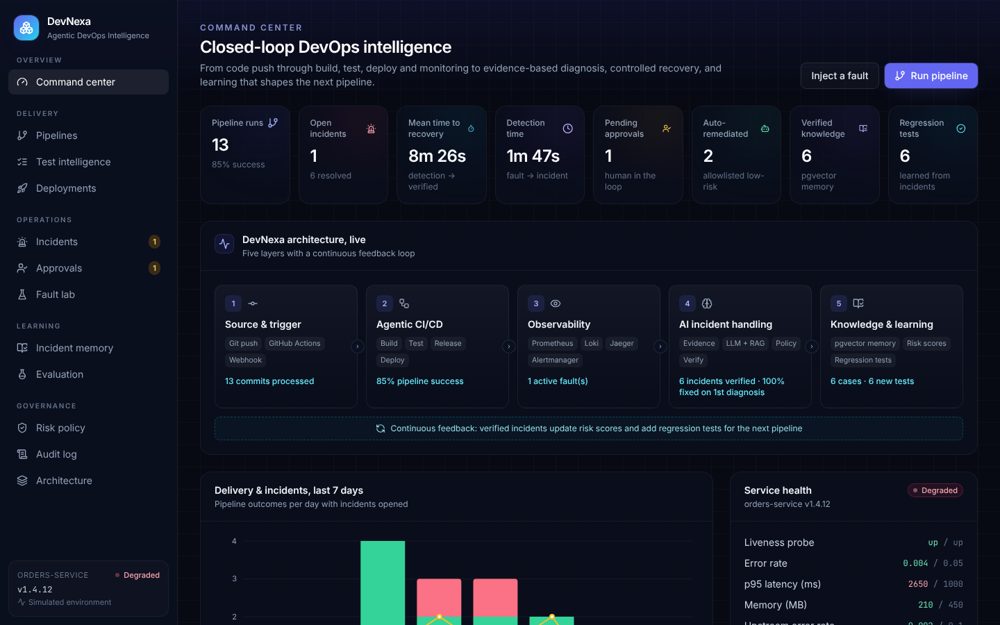
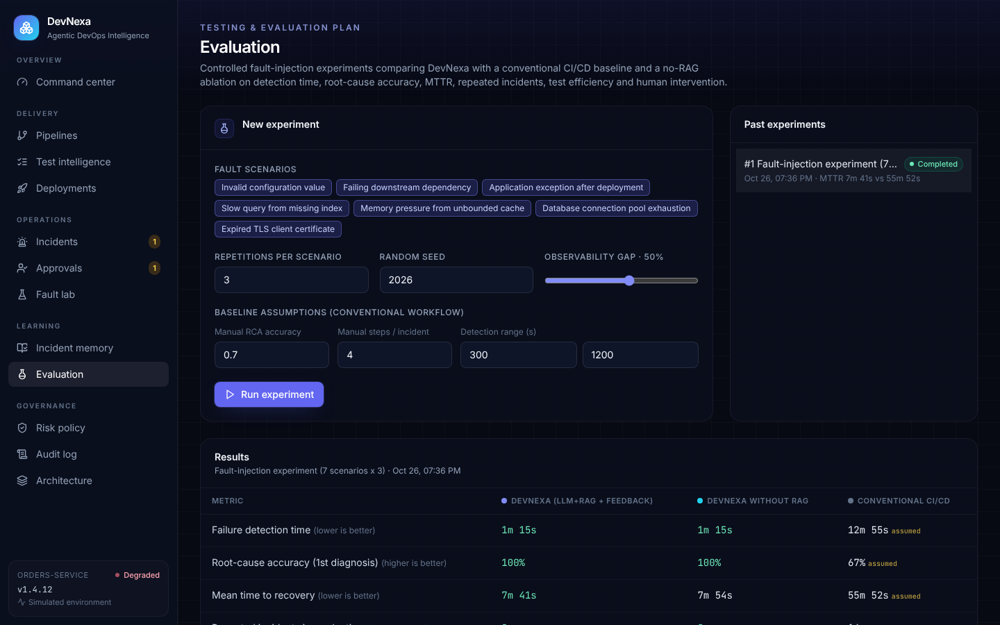

# DevNexa: Agentic DevOps Intelligence Platform

DevNexa is a closed-loop, AI-assisted DevOps prototype. Specialised agents build, test, release and deploy a
sample microservice; monitoring alerts open incidents; the Incident Agent collects evidence, retrieves similar
**verified** incidents from a pgvector memory, diagnoses the likely root cause with an LLM (RAG), and acts within a
risk-based policy. Health checks verify every fix, and only verified knowledge feeds back into future test
prioritisation and release risk.



## What's in the box

| Synopsis module | Where it lives |
| --- | --- |
| Code change & trigger (GitHub push, GitHub Actions, webhook) | `backend/app/api/webhooks.py`, `.github/workflows/devnexa-pipeline.yml` |
| Build, Test, Release and Deployment agents (LangGraph) | `backend/app/agents/cicd.py` |
| AI-assisted build/test failure feedback | `backend/app/services/analyzer.py` (`explain_ci_failure`) |
| Observability: Prometheus, Alertmanager, Loki, OpenTelemetry + Jaeger, Grafana | `infra/`, `docker-compose.yml`, `sample-app/` |
| Incident evidence collection (logs, metrics, traces, commits, deployments) | `backend/app/services/telemetry.py` |
| LLM + RAG diagnosis with re-analysis loop (LangGraph) | `backend/app/agents/incident.py`, `backend/app/services/analyzer.py`, `backend/app/services/retrieval.py` |
| Graded autonomy and approvals (low / medium / high risk) | `backend/app/services/policy.py`, Approvals + Risk policy pages |
| Remediation and health verification | `backend/app/services/environment.py`, `verify` node in the incident graph |
| Feedback Engine (verified memory, module risk, regression tests, test prioritisation) | `backend/app/services/feedback.py` |
| Fault-injection evaluation vs a conventional baseline | `backend/app/evaluation/runner.py`, Evaluation page |
| Audit log of every agent decision | `backend/app/services/audit.py`, Audit page |
| Dashboard (React, Vite, Tailwind CSS, Recharts) | `frontend/` |

## Quick start (no Docker, simulated environment)

```bash
# backend
cd backend
python -m venv .venv && source .venv/bin/activate
pip install -r requirements-dev.txt
uvicorn app.main:app --reload            # http://localhost:8000/docs

# dashboard (second terminal)
cd frontend
npm install
npm run dev                              # http://localhost:5173
```

The backend uses SQLite and an in-memory model of the sample `orders-service`. On first start it replays a few
days of history through the real agent graphs so the dashboard and incident memory are not empty.

Try the loop:

1. **Fault lab**: inject *Failing downstream dependency*. Monitoring opens an incident, the agent diagnoses it,
   the low-risk restart runs automatically, health checks pass, and the case is stored in memory.
2. Inject *Expired TLS client certificate*. Rotating a certificate is high risk, so the incident waits in
   **Approvals** with its evidence until you approve.
3. Ship *Memory pressure from unbounded cache* through a commit. If that cause was learned before, the regression
   test added by the Feedback Engine fails the pipeline and the defect never reaches production.
4. **Evaluation**: run a fault-injection experiment and compare DevNexa, a no-RAG ablation and a conventional
   CI/CD baseline.

## Full stack (Docker Compose, live mode)

```bash
docker compose up --build
```

| Service | URL |
| --- | --- |
| Dashboard | http://localhost:5173 |
| API / Swagger UI | http://localhost:8000/docs |
| Sample app (orders-service) | http://localhost:8081 |
| Grafana | http://localhost:3000 |
| Prometheus / Alertmanager | http://localhost:9090 / http://localhost:9093 |
| Jaeger | http://localhost:16686 |

In live mode the backend uses PostgreSQL + pgvector, the sample app generates its own traffic, Prometheus
evaluates `infra/prometheus/alerts.yml`, Alertmanager posts to `/api/webhooks/alertmanager`, and evidence is pulled
from Prometheus, Loki and Jaeger. Faults are injected and remediated through the sample app's admin API (and
`docker restart` for container restarts). Set `DEVNEXA_MODE=simulated` to run the compose stack against the
simulated environment instead.

## Configuration

All settings are environment variables with the `DEVNEXA_` prefix (see `backend/.env.example`).

| Variable | Default | Meaning |
| --- | --- | --- |
| `DEVNEXA_DATABASE_URL` | `sqlite:///./devnexa.db` | Use `postgresql+psycopg://…` for pgvector retrieval |
| `DEVNEXA_ENVIRONMENT_MODE` | `simulated` | `simulated` or `live` |
| `DEVNEXA_LLM_PROVIDER` | `heuristic` | `heuristic` (offline evidence scorer), `anthropic`, or `openai` (any OpenAI-compatible endpoint, including Ollama/vLLM via `DEVNEXA_LLM_BASE_URL`) |
| `DEVNEXA_LLM_MODEL` / `DEVNEXA_LLM_API_KEY` | | Model and key for the LLM provider |
| `DEVNEXA_GITHUB_WEBHOOK_SECRET` | | HMAC secret for `/api/webhooks/github` and token for the Actions reporter |
| `DEVNEXA_SIM_STEP_DELAY` | `0.8` | Seconds per simulated step, so progress is visible in the UI |
| `DEVNEXA_EMBEDDING_PROVIDER` | `hashing` | `sentence-transformers` if installed |

If the LLM call fails, the analyzer falls back to the offline scorer and records that in the diagnosis.

## Connecting GitHub

* **Webhook**: add a repository webhook (push events) pointing at `https://<devnexa>/api/webhooks/github` with
  the shared secret. Each push becomes a DevNexa pipeline run.
* **GitHub Actions**: add `DEVNEXA_URL` and `DEVNEXA_TOKEN` repository secrets. `devnexa-pipeline.yml` asks DevNexa
  for a prioritised test plan, runs the real build and tests of `sample-app/`, and reports each stage; failures get
  an AI explanation in the dashboard.

## How the incident workflow decides

```
alert → collect evidence → retrieve similar verified incidents (pgvector) → LLM diagnosis
      → policy: low+allowlisted → execute │ medium → recommend, approval │ high → human approval
      → execute → verify health ─ pass → Feedback Engine stores knowledge, raises module risk, adds regression test
                                 └ fail → reject the cause, re-analyse (max 2), then escalate to a human
```

A diagnosis is never reported as a fix unless post-action health checks pass.

## Evaluation

`POST /api/experiments` (or the Evaluation page) replays the same randomised sequence of controlled faults against
three variants on a simulated clock: DevNexa, DevNexa without RAG, and a conventional CI/CD workflow. It reports
failure-detection time, root-cause accuracy, MTTR, repeated incidents, test efficiency and human intervention.
DevNexa variants are measured by executing the agent graphs; the conventional baseline's human timings and
diagnosis accuracy cannot be executed, so they are explicit, editable assumptions and are labelled as such in the
report. As the synopsis states, these are prototype results on a simulated environment, not production claims.



## Tests

```bash
cd backend && pytest -q        # agents, policy, RAG, feedback loop, webhooks, experiments
cd sample-app && pytest -q     # fault injection and remediation in the sample service
cd frontend && npm run build
```

## Repository layout

```
backend/      FastAPI app, LangGraph agents, services, evaluation harness, tests
frontend/     React + Vite + Tailwind + Recharts dashboard
sample-app/   orders-service with Prometheus metrics, OTel traces, admin fault API
infra/        Prometheus rules, Alertmanager, Loki, Promtail, Grafana provisioning
docs/         Architecture notes and screenshots
```

See [docs/architecture.md](docs/architecture.md) for the design in more detail.
