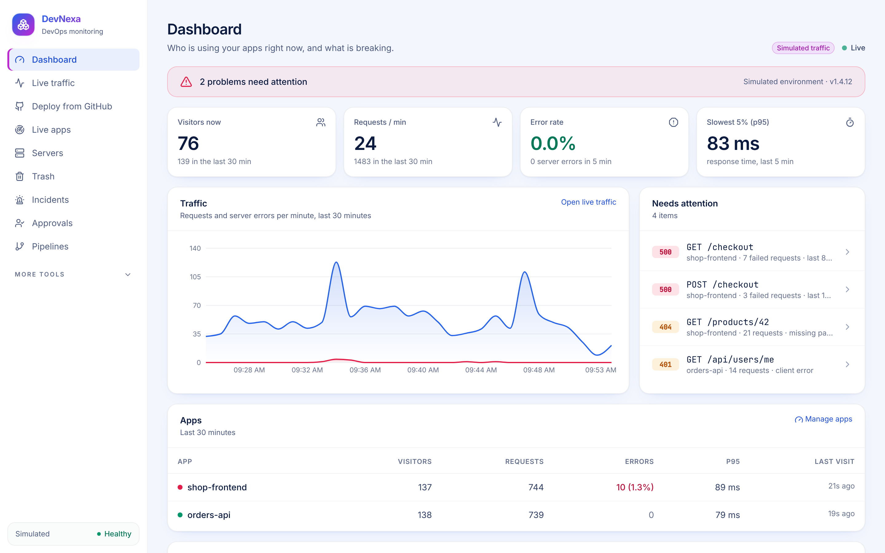
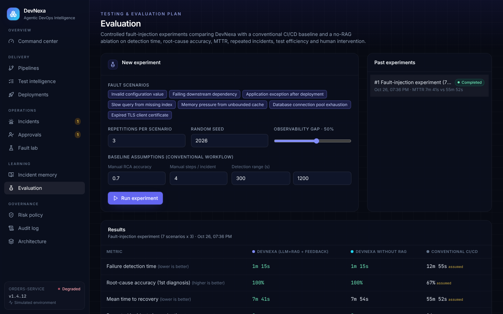

# DevNexa: Agentic DevOps Intelligence Platform

DevNexa is a closed-loop, AI-assisted DevOps prototype. Specialised agents build, test, release and deploy a
sample microservice; monitoring alerts open incidents; the Incident Agent collects evidence, retrieves similar
**verified** incidents from a pgvector memory, diagnoses the likely root cause with an LLM (RAG), and acts within a
risk-based policy. Health checks verify every fix, and only verified knowledge feeds back into future test
prioritisation and release risk.



## What's in the box

| Synopsis module | Where it lives |
| --- | --- |
| Code change & trigger (GitHub push, GitHub Actions, webhook) | `backend/app/api/webhooks.py`, `.github/workflows/devnexa-pipeline.yml` |
| Build, Test, Release and Deployment agents (LangGraph) | `backend/app/agents/cicd.py` |
| AI-assisted build/test failure feedback | `backend/app/services/analyzer.py` (`explain_ci_failure`) |
| Observability: Prometheus, Alertmanager, Loki, OpenTelemetry + Jaeger, Grafana | `infra/`, `docker-compose.yml`, `sample-app/` |
| Incident evidence collection (logs, metrics, traces, commits, deployments) | `backend/app/services/telemetry.py` |
| LLM + RAG diagnosis with re-analysis loop (LangGraph) | `backend/app/agents/incident.py`, `backend/app/services/analyzer.py`, `backend/app/services/retrieval.py` |
| Graded autonomy and approvals (low / medium / high risk) | `backend/app/services/policy.py`, Approvals + Risk policy pages |
| Remediation and health verification | `backend/app/services/environment.py`, `verify` node in the incident graph |
| Feedback Engine (verified memory, module risk, regression tests, test prioritisation) | `backend/app/services/feedback.py` |
| Fault-injection evaluation vs a conventional baseline | `backend/app/evaluation/runner.py`, Evaluation page, results in [docs/evaluation-report.md](docs/evaluation-report.md) |
| Real build, test and deploy in live mode (docker build, pytest in the image, container swap with rollback) | `backend/app/agents/realci.py` |
| Audit log of every agent decision | `backend/app/services/audit.py`, Audit page |
| Dashboard (React, Vite, Tailwind CSS, Recharts) | `frontend/` |

## Quick start (no Docker, simulated environment)

```bash
# backend
cd backend
python -m venv .venv && source .venv/bin/activate
pip install -r requirements-dev.txt
uvicorn app.main:app --reload            # http://localhost:8000/docs

# dashboard (second terminal)
cd frontend
npm install
npm run dev                              # http://localhost:5173
```

The backend uses SQLite and an in-memory model of the sample `orders-service`. On first start it replays a few
days of history through the real agent graphs so the dashboard and incident memory are not empty.

Try the loop:

1. **Fault lab**: inject *Failing downstream dependency*. Monitoring opens an incident, the agent diagnoses it,
   the low-risk restart runs automatically, health checks pass, and the case is stored in memory.
2. Inject *Expired TLS client certificate*. Rotating a certificate is high risk, so the incident waits in
   **Approvals** with its evidence until you approve.
3. Ship *Memory pressure from unbounded cache* through a commit. If that cause was learned before, the regression
   test added by the Feedback Engine fails the pipeline and the defect never reaches production.
4. **Evaluation**: run a fault-injection experiment and compare DevNexa, a no-RAG ablation and a conventional
   CI/CD baseline.

## Full stack (Docker Compose, live mode)

```bash
docker compose up --build
```

| Service | URL |
| --- | --- |
| Dashboard | http://localhost:5173 |
| API / Swagger UI | http://localhost:8000/docs |
| Sample app (orders-service) | http://localhost:8081 |
| Grafana | http://localhost:3000 |
| Prometheus / Alertmanager | http://localhost:9090 / http://localhost:9093 |
| Jaeger | http://localhost:16686 |

In live mode the backend uses PostgreSQL + pgvector, the sample app generates its own traffic, Prometheus
evaluates `infra/prometheus/alerts.yml`, Alertmanager posts to `/api/webhooks/alertmanager`, and evidence is pulled
from Prometheus, Loki and Jaeger. Faults are injected and remediated through the sample app's admin API (and
`docker restart` for container restarts). Set `DEVNEXA_MODE=simulated` to run the compose stack against the
simulated environment instead.

### Public deployment with HTTPS

Point your domain's A record at the server, open ports 80 and 443 in its firewall, then:

```bash
echo "DEVNEXA_DOMAIN=devnexa.example.com" >> .env
docker compose --profile https up -d --build
```

The `caddy` service obtains and renews a Let's Encrypt certificate and redirects HTTP to HTTPS. The dashboard has
no login of its own, so only expose ports 80 and 443 publicly and keep the others (5432, 8000, 3000, 9090, …)
closed in the server's firewall or cloud security group.

## Deploy from GitHub (any repo, live URL, live logs)

The **Deploy from GitHub** page lets you connect a GitHub account, pick one of your repositories and a branch, and
deploy it as a container on the DevNexa server:

1. **Clone** the branch with your token (the token is masked in every log line).
2. **Detect** how to build it: the repo's own `Dockerfile`, or a generated one for Node (Express/Next, or Vite/CRA
   served by nginx), Python (FastAPI, Flask, Django, Streamlit, plain script), Go, or a static `index.html` site.
3. **Build** with `docker build` and **start** the container on the compose network with memory/CPU limits.
4. **Health-check** it over HTTP, then switch the app's URL to the new container (blue/green: the previous version
   keeps serving until the new one is healthy, then it is removed).

Build output and the running app's `docker logs` stream live to the page (server-sent events). The Monitoring
Agent probes every running app every 15 s (HTTP status, latency, CPU, memory, error lines in the logs).

When a deploy or a running app fails, the Deploy Agent follows the same loop as the incident workflow:
**diagnose** (known failure patterns + the configured LLM, with the log evidence and key repo files), **recall**
similar past fixes, apply **graded remediation** and **verify**, then **learn** the outcome:

| Risk | Runs | Examples |
| --- | --- | --- |
| Low (allowlisted) | automatically, if "auto-execute low risk" is on in Risk policy | retry after a network error, rebuild with `npm install` when the lockfile is out of sync, route to the port the app really listens on, restart a crashed container (up to 3 times), free Docker disk space |
| Medium | after approval | double the memory limit after an out-of-memory kill, roll back to the last healthy image |
| Code fix | automatically on a **new branch** (switch off in Risk policy: "Fix deploys on a new branch") | push the fix to `devnexa/fix-<app>-<id>`, deploy that branch to a preview URL `https://<app>-fix-<id>.<domain>`, and open a pull request only once the preview is healthy. Examples: add the missing package to `requirements.txt` / `package.json`, replace a repo Dockerfile that does not build with a generated one, or an LLM-written patch |

Your base branch and the running app are never changed by an agent fix: you test the preview URL, merge the pull
request, and the push webhook redeploys the app from the merged code.

**Repos that are not Docker-ready.** When a repo has no Dockerfile, DevNexa generates one for its stack and
deploys with it. Once that deploy passes its health check, the agent opens a pull request
(`devnexa/dockerize-<app>`) that adds the generated `Dockerfile` and a `.dockerignore`, once per repo and branch.

### Sign in with GitHub

Users sign in with their GitHub account instead of pasting a token. DevNexa then lists the repositories that account
can access, clones with that account's access, and pushes fix branches and pull requests as that account.

1. On GitHub open **Settings → Developer settings → OAuth Apps → New OAuth App**
   (<https://github.com/settings/applications/new>), or the same page under an organization's settings.
2. Fill in:
   * **Application name**: `DevNexa`
   * **Homepage URL**: `https://devnexa.example.com`
   * **Authorization callback URL**: `https://devnexa.example.com/api/auth/github/callback`
3. **Register application**, copy the **Client ID**, then **Generate a new client secret** and copy it.
4. Add to `.env` next to `docker-compose.yml` and restart (`docker compose --profile https up -d`):

   ```bash
   DEVNEXA_GITHUB_CLIENT_ID=Ov23li...
   DEVNEXA_GITHUB_CLIENT_SECRET=...
   DEVNEXA_PUBLIC_URL=https://devnexa.example.com
   DEVNEXA_GITHUB_ALLOWED_USERS=your-login,teammate   # who may sign in
   ```

Deploying runs code on your server, so only the logins in `DEVNEXA_GITHUB_ALLOWED_USERS` can sign in. If it is
empty, the first account that signs in becomes the only owner. The OAuth app asks for the `repo` scope (needed to
clone private repos and open pull requests) and `read:user`. Organization repos appear once the organization
approves the OAuth app (GitHub shows a "Request" button on the consent screen). Tokens stay on the server; the
browser only gets a signed session cookie. The admin key still works as a fallback.

### Turning it on (server)

```bash
# .env next to docker-compose.yml
DEVNEXA_ADMIN_TOKEN=<long random string>   # fallback login (or set up Sign in with GitHub)
DEVNEXA_DOMAIN=devnexa.example.com
DEVNEXA_APPS_DOMAIN=devnexa.example.com    # apps at https://<app>.devnexa.example.com
```

* Add a **wildcard DNS record** `*.devnexa.example.com` (A record) pointing at the same server IP.
  Caddy then issues a certificate per app on first visit, only for app names DevNexa knows.
* `docker compose --profile https up -d --build`, open the dashboard and **Sign in with GitHub** (above), or enter
  the admin key and paste a GitHub token
  (classic token with the `repo` scope, or a fine-grained token with *Contents: read & write* and
  *Pull requests: read & write* for the repos you want; write access is only used for approved fix PRs).
* Without `DEVNEXA_APPS_DOMAIN`, each app is published on a host port instead (`http://<domain>:20000-20999`),
  which needs those ports open in the firewall.

## After deploy: live issues, fixes on test URLs, versions and backups

The **Live apps** page (`/live`) is where a deployed app is looked after.

**Live issues.** Each app's issues are grouped by page, with the section they happen in:

* **Browser:** every build adds a small script (`/__devnexa/agent.js`) to the app's static `index.html` (in the
  build only, never committed). It reports JavaScript errors, failed API calls (5xx or network), images and
  scripts that fail to load, console errors and warnings, blank pages and empty sections, with the page path,
  the CSS selector of the section, the element clicked last and the screen size. Server-rendered apps add the
  `<script>` tag shown under Pipeline settings to their layout.
* **Point at a problem:** opening the site with `?devnexa-report=1` (or pressing Alt+Shift+R) lets a person click
  the broken section and say what is wrong; the selector, text and HTML of that section are sent with it.
* **Server:** the Monitoring Agent turns error lines and HTTP 5xx access-log lines from the container into issues.
* **Scan pages:** crawls the app's pages and flags HTTP errors, broken assets and pages with no content.

Repeats are one issue with a count, and an issue that comes back after its fix was merged is reopened.

**Fix on a test URL, merge on approval.** "Fix it on a test URL" (or auto-fix, once an error repeats 3 times)
runs the Fix Agent: it clones the live commit, picks the files related to the page, section and error, asks the
configured LLM for a minimal patch (or writes a mechanical fix such as a missing dependency), commits it to
`devnexa/issue-<app>-<issue>`, opens a pull request and deploys that branch to **`https://<app>-pr-<N>.<domain>`**.
Pushing more commits to the branch redeploys the test URL. **Approve and merge** merges the PR, removes the test
deployment and redeploys the app; **Reject** closes the PR and removes it. Any branch can get a test URL the same
way ("Test a branch"). Without an LLM provider only mechanical fixes are possible, and the issue says so.

**Versions and backups.** Every successful deploy of the app's branch (a push, a merged fix, a redeploy) is tagged
`devnexa-app/<app>:v<N>`; the previous versions are kept as backups (5 by default) and can be put live again with
one click, without a rebuild. Backup schedules snapshot the running container (`docker commit`) every N hours and
keep the last K; each schedule can be removed from the page.

**Pipeline settings.** The deploy steps are listed in order; the optional ones can be switched off per app:
keeping backups, the **load balancer** (2-4 containers of the live version, requests rotated across the healthy
ones by the router), browser issue capture, and auto-fix.

## Remote servers (deploy to other machines over SSH)

The **Servers** page adds other Linux machines (another EC2 instance, a VPS, a lab box) as deploy targets.

1. **Add a server**: name, host, SSH user and port. DevNexa generates an ed25519 key for it (or you paste your
   own key, such as the EC2 `.pem`; passphrase-protected keys are refused because deploys run unattended).
2. Run the **authorize command** it shows once on that server, then press **Check connection**. DevNexa logs in
   and shows the OS, CPU, memory, disk, Docker version and every container. If Docker is missing, **Install
   Docker** runs get.docker.com (the SSH user needs root or passwordless sudo).
3. On **Deploy from GitHub**, pick the server in the **Server** dropdown. The default is the DevNexa host itself.

How it works: each server's key, known host key and a `Host devnexa-server-<id>` block are written (mode 600)
under `DEVNEXA_SERVERS_DIR`, and the backend's `~/.ssh/config` includes them. Every Docker command for an app on
that server runs with `DOCKER_HOST=ssh://devnexa-server-<id>`, so the image is built and run by the server's own
Docker engine, and the Deploy, Monitoring and Fix agents, releases, backups and rollbacks work the same as locally.
The app publishes a port on the server (`port_base + deploy id % 1000`, 20000 and up by default). With
`DEVNEXA_APPS_DOMAIN` set, `https://<app>.<domain>` still works: Caddy on the DevNexa host proxies to
`<server address>:<port>`. Without it, the URL is `http://<server address>:<port>`. Redeploys, push deploys,
agent fixes and test URLs stay on the app's server.

The server page also has a **remote terminal** (one command at a time, as the SSH user, each one written to the
audit log) and logs, restart, stop and start for every container. All of it needs the same sign-in as deploying.

Network: the server's firewall or security group must allow SSH (22) from the DevNexa server, and the app port
range from the DevNexa server (or from everyone, if you use the plain `http://host:port` URLs). The load-balancer
replicas step runs only on the DevNexa host; apps on remote servers serve from one container.

## Live traffic and failing pages

The dashboard opens on what users are doing right now: visitors, requests per minute, error rate and p95 response
time for every app deployed from GitHub, plus a **Needs attention** list that puts failing pages (5xx), missing
pages (404), open incidents and pending approvals in one place. **Live traffic** shows the full request log with
filters for app, time window, errors only and a single page.

How it works: the `caddy` service writes one JSON line per app request to `/var/log/caddy/access.log` (shared
`caddy_logs` volume). The backend tails that file and keeps the last hour in memory; `GET /api/traffic` serves it.
Client IPs are masked before they leave the server. Traffic is recorded only for apps served through Caddy, so it
needs `--profile https` and `DEVNEXA_APPS_DOMAIN`. In simulated mode the dashboard shows generated traffic and
labels it "Simulated". Set `DEVNEXA_TRAFFIC_SOURCE=off` to disable it.

## Configuration

All settings are environment variables with the `DEVNEXA_` prefix (see `backend/.env.example`).

| Variable | Default | Meaning |
| --- | --- | --- |
| `DEVNEXA_DATABASE_URL` | `sqlite:///./devnexa.db` | Use `postgresql+psycopg://…` for pgvector retrieval |
| `DEVNEXA_ENVIRONMENT_MODE` | `simulated` | `simulated` or `live` |
| `DEVNEXA_LLM_PROVIDER` | `heuristic` | `heuristic` (offline evidence scorer), `anthropic`, or `openai` (any OpenAI-compatible endpoint, including Ollama/vLLM via `DEVNEXA_LLM_BASE_URL`) |
| `DEVNEXA_LLM_MODEL` / `DEVNEXA_LLM_API_KEY` | | Model and key for the LLM provider |
| `DEVNEXA_GITHUB_WEBHOOK_SECRET` | | HMAC secret for `/api/webhooks/github` and token for the Actions reporter |
| `DEVNEXA_SIM_STEP_DELAY` | `0.8` | Seconds per simulated step, so progress is visible in the UI |
| `DEVNEXA_EMBEDDING_PROVIDER` | `hashing` | `sentence-transformers` if installed |
| `DEVNEXA_ADMIN_TOKEN` | | Unlocks the Deploy from GitHub page and API (live mode needs this or GitHub sign-in) |
| `DEVNEXA_GITHUB_CLIENT_ID` / `DEVNEXA_GITHUB_CLIENT_SECRET` | | GitHub OAuth app for Sign in with GitHub |
| `DEVNEXA_GITHUB_ALLOWED_USERS` | | GitHub logins allowed to sign in (empty: first account to sign in is the owner) |
| `DEVNEXA_PUBLIC_URL` | from request | Dashboard URL, used for the OAuth callback (`https://devnexa.example.com`) |
| `DEVNEXA_SESSION_SECRET` | generated | Key that signs session cookies (generated and stored in the DB if empty) |
| `DEVNEXA_APPS_DOMAIN` | | Serve deployed apps at `https://<app>.<domain>` (needs wildcard DNS) |
| `DEVNEXA_GITHUB_TOKEN` | | Optional default GitHub token (otherwise connect one in the dashboard) |
| `DEVNEXA_APPS_MEMORY` / `DEVNEXA_APPS_CPUS` | `512m` / `1.0` | Resource limits per deployed app |
| `DEVNEXA_SERVERS_DIR` | `/tmp/devnexa-servers` | Where remote-server SSH keys and config are written (rebuilt from the database when missing) |

If the LLM call fails, the analyzer falls back to the offline scorer and records that in the diagnosis.

## Connecting GitHub

* **Webhook**: add a repository webhook (push events) pointing at `https://<devnexa>/api/webhooks/github` with
  the shared secret. If the pushed repo and branch have an app running from **Deploy from GitHub**, the push
  rebuilds and redeploys it (continuous deployment). Otherwise the push becomes a DevNexa pipeline run. In live mode
  that run is real:
  * the Build Agent fetches the pushed commit and runs `docker build` on `sample-app/`;
  * the Test Agent runs its pytest suite inside the new image;
  * the Deployment Agent replaces the `devnexa-sample-app` container with the new image, and puts the previous
    image back if the new one fails its health check.

  Fault Lab runs stay simulated.
* **GitHub Actions**: add `DEVNEXA_URL` and `DEVNEXA_TOKEN` repository secrets. `devnexa-pipeline.yml` asks DevNexa
  for a prioritised test plan, runs the real build and tests of `sample-app/`, checks release readiness, and
  reports build, test and release (the last one completes the run). Failures get an AI explanation in the dashboard.
* **Commit evidence**: with GitHub connected (the Deploy page or `DEVNEXA_GITHUB_TOKEN`) and `DEVNEXA_GITHUB_REPO`
  set (compose defaults it to this repo), incidents include the repo's latest real commits and the files they
  changed.

## How the incident workflow decides

```
alert → collect evidence → retrieve similar verified incidents (pgvector) → LLM diagnosis
      → policy: low+allowlisted → execute │ medium → recommend, approval │ high → human approval
      → execute → verify health ─ pass → Feedback Engine stores knowledge, raises module risk, adds regression test
                                 └ fail → reject the cause, re-analyse (max 2), then escalate to a human
```

A diagnosis is never reported as a fix unless post-action health checks pass.

## Evaluation

`POST /api/experiments` (or the Evaluation page) replays the same randomised sequence of controlled faults against
three variants on a simulated clock: DevNexa, DevNexa without RAG, and a conventional CI/CD workflow. It reports
failure-detection time, root-cause accuracy, MTTR, repeated incidents, test efficiency and human intervention.
DevNexa variants are measured by executing the agent graphs; the conventional baseline's human timings and
diagnosis accuracy cannot be executed, so they are explicit, editable assumptions and are labelled as such in the
report. As the synopsis states, these are prototype results on a simulated environment, not production claims.



## Tests

```bash
cd backend && pytest -q        # agents, policy, RAG, feedback loop, webhooks, experiments
cd sample-app && pytest -q     # fault injection and remediation in the sample service
cd frontend && npm run build
```

## Repository layout

```
backend/      FastAPI app, LangGraph agents, services, evaluation harness, tests
frontend/     React + Vite + Tailwind + Recharts dashboard
sample-app/   orders-service with Prometheus metrics, OTel traces, admin fault API
infra/        Prometheus rules, Alertmanager, Loki, Promtail, Grafana provisioning
docs/         Architecture notes and screenshots
```

See [docs/architecture.md](docs/architecture.md) for the design in more detail.
