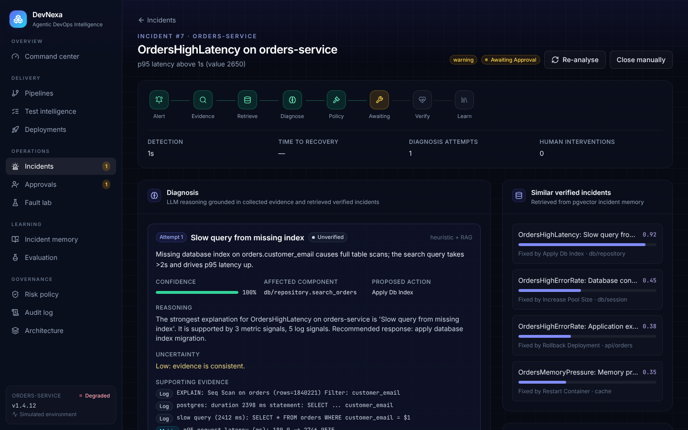

# DevNexa architecture

## Layers

1. **Source and trigger**: GitHub push webhooks (`/api/webhooks/github`, HMAC-verified), GitHub Actions stage
   reports (`/api/webhooks/github/actions`), or manual pushes from the dashboard create a `PipelineRun`.
2. **Agentic CI/CD pipeline**: a LangGraph `StateGraph` with `build → test → release → deploy` nodes and
   conditional edges that stop on failure. Each node is an agent:
   * *Build Agent* resolves dependencies and builds the image; failures go to `explain_ci_failure`.
   * *Test Agent* ranks tests with `prioritize_tests` (changed modules, learned module risk, regression tests,
     failure history, smoke tests, duration) or runs the full suite for the baseline strategy.
   * *Release Agent* checks readiness and a change-risk gate.
   * *Deployment Agent* deploys, runs a liveness check, and rolls back automatically if the release does not start.
3. **Observability**: the sample app exports Prometheus metrics, structured logs (Promtail → Loki) and
   OpenTelemetry spans (→ Jaeger). Alert rules in `infra/prometheus/alerts.yml` mirror `ALERT_RULES` in
   `backend/app/agents/monitoring.py`, which evaluates them against the simulated environment.
4. **AI incident handling**: a second LangGraph graph:
   `collect_evidence → retrieve → diagnose → decide → execute → verify → learn`, with `verify → retrieve` as the
   re-analysis loop (failed causes are excluded) and `escalate` as the exit after `max_reanalysis_attempts`.
   Approval pauses the graph; approving an action resumes it at `execute`.
5. **Knowledge and learning**: after verification the Feedback Engine writes a `KnowledgeEntry` with its
   embedding (pgvector `vector(384)` on PostgreSQL), raises `ModuleRisk` for the affected module, and adds the
   confirmed missed test as a regression `TestCase` that the Test Agent will prioritise next time.

## Diagnosis

The analyzer receives the alert, the evidence (log lines, metric anomalies, trace spans, recent commits and
deployments) and the retrieved verified incidents.

* `LLMAnalyzer` sends this context to Anthropic or any OpenAI-compatible endpoint with instructions to answer only
  from the evidence and to return JSON (cause, component, confidence, uncertainty, reasoning, supporting
  evidence, alternatives, proposed action). Unknown ids are mapped to `unknown`/runbook defaults.
* `HeuristicAnalyzer` is the offline default and the fallback: weighted log, metric, span and change rules plus a
  retrieval term that uses the best-matching verified case per cause, sharpened relative to the best overall
  match. Confidence is a softmax over cause scores.

## Policy

`services/policy.py` combines each action's risk level and allowlist flag (`PolicyRule`, editable in the UI) with
autonomy settings (auto-execute low risk, optional medium-risk automation, minimum confidence). High-risk actions
cannot be allowlisted through the API. Every outcome is written to the audit log.

## Environments

`SimulatedEnvironment` models the orders-service: faults, metrics, health checks, deployments, rollbacks and the
effect of each remediation action. `LiveEnvironment` drives the docker-compose sample app through its admin API
and Prometheus. Both expose the same interface, so agents are unaware of the mode.

## Data model

`pipeline_runs`, `stage_runs`, `test_cases`, `test_executions`, `deployments`, `alerts`, `incidents`,
`evidence_items`, `diagnoses`, `remediation_actions`, `health_checks`, `knowledge_entries`, `module_risk`,
`policy_rules`, `audit_log`, `experiment_runs`, `kv_store`.
